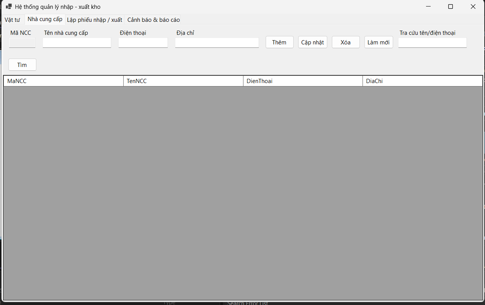
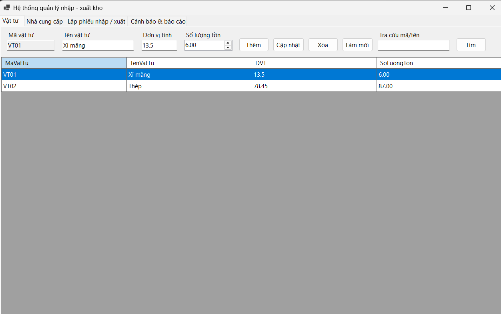
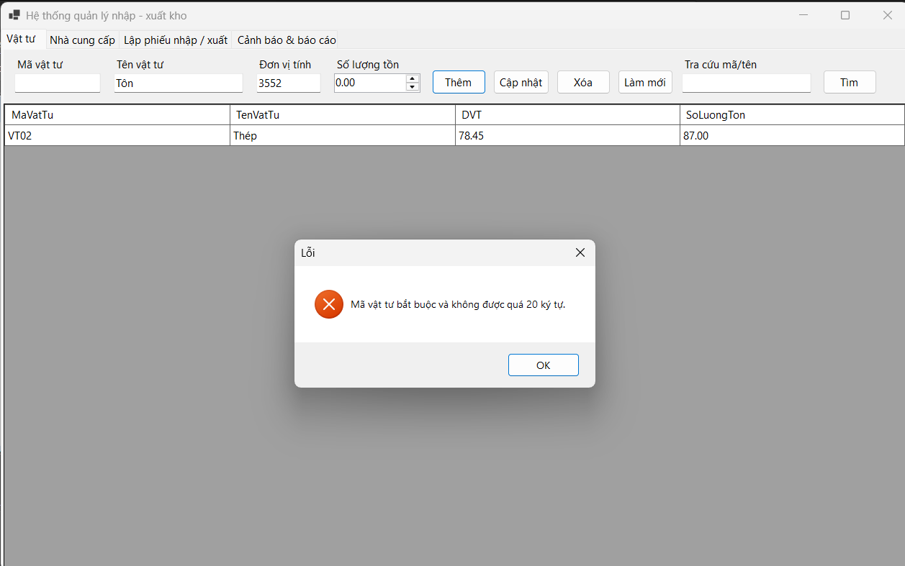

# Bài 5.5 - Quản lý kho vật tư

* **Họ và tên:** Nguyễn Minh Trí - **MSSV:** 24810320227

## Cấu trúc thư mục (3-Tier)
```
Bai5.5/
├── Database/ScriptDB.sql   # Tạo CSDL và dữ liệu mẫu
├── Bai5.5/
│   ├── DTO/               # Lớp chứa dữ liệu
│   ├── DAL/               # Truy cập CSDL (ADO.NET - MySql.Data)
│   ├── BUS/               # Xử lý nghiệp vụ
│   ├── GUI/               # Form WinForms
│   └── App.config / Program.cs
├── README.md
└── Bai5.5.slnx
```

## Hướng dẫn chạy
1. Chạy `Database/ScriptDB.sql` trong MySQL Workbench.
2. Sửa chuỗi kết nối trong `Bai5.5/App.config` cho khớp MySQL trên máy.
3. Mở `Bai5.5.slnx` bằng Visual Studio và nhấn F5.

## Kết quả thực hành
### 1. Ảnh màn hình Giao diện chính

---
.png)
---
.png)
---
.png)
---
### 2. Ảnh màn hình kết quả

---------
.png)
---------
.png)
---------
.png)
---------
.png)
---------
.png)
---------

### 3. Ảnh màn hình Kiểm tra lỗi (Validation)

---
