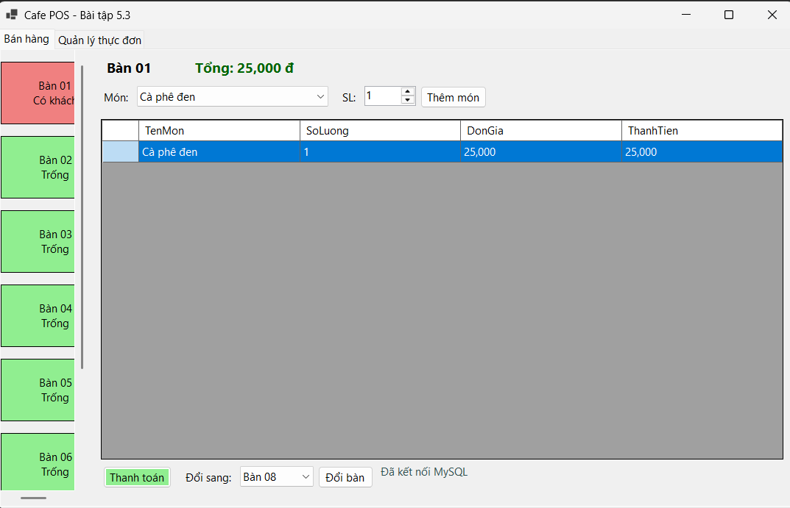
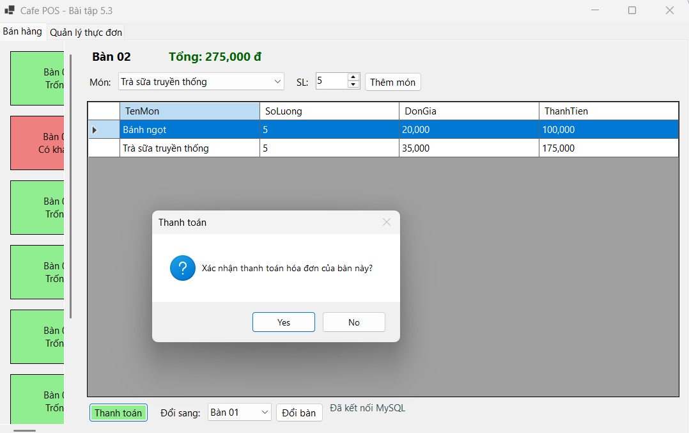
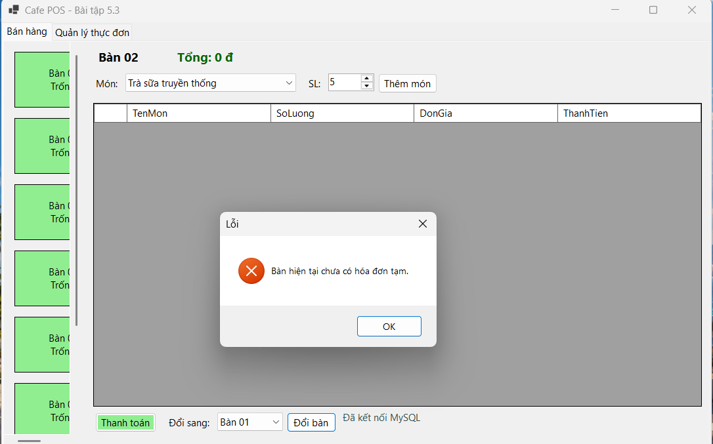
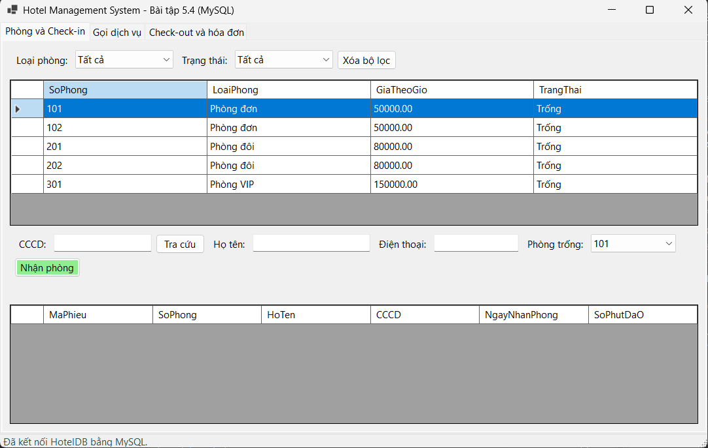
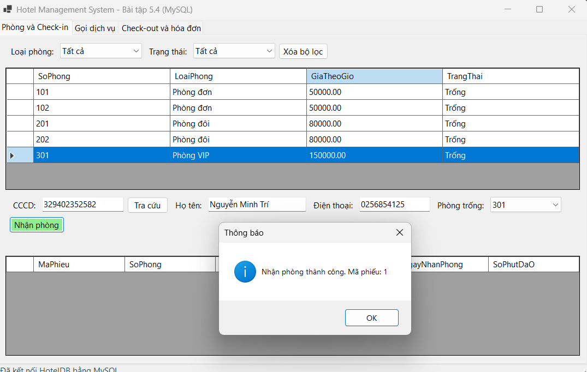
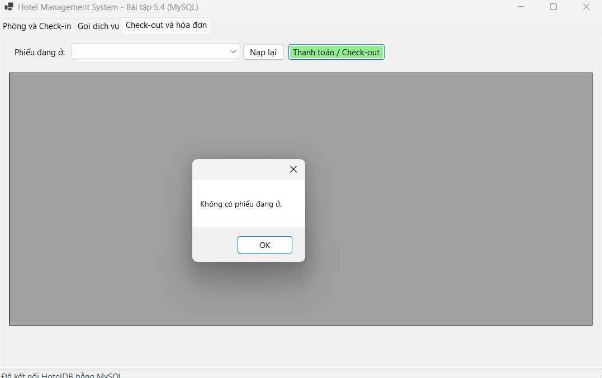

# BÁO CÁO BÀI TẬP 5.3 - 5.4 - 5.5

## I. THÔNG TIN SINH VIÊN
* **Họ và tên:** Nguyễn Minh Trí
* **Mã số sinh viên:** 24810320227
* **Lớp: D19QTANM1**
* **Lớp học phần:** Lập trình .NET 
* **Link Repository:** https://github.com/familo23/BaiTap5.3-5.4-5.5
---
## CẤU TRÚC THƯ MỤC (3-Tier Architecture)
Mỗi bài là một Solution riêng, cùng cấu trúc:
```
Bai5.x/
├── Database/
│   └── ScriptDB.sql      # Script tạo CSDL và chèn dữ liệu mẫu
├── Bai5.x/
│   ├── DTO/              # Lớp chứa dữ liệu (Data Transfer Object)
│   ├── DAL/              # Lớp thao tác CSDL (ADO.NET)
│   ├── BUS/              # Lớp xử lý nghiệp vụ
│   ├── GUI/              # Form WinForms
│   └── App.config / Program.cs
├── README.md             # Báo cáo chi tiết bài tập
└── Bai5.x.slnx
```
* [Bài 5.3 - Quản lý quán Cafe](./Bai5.3/README.md)
* [Bài 5.4 - Quản lý khách sạn](./Bai5.4/README.md)
* [Bài 5.5 - Quản lý kho vật tư](./Bai5.5/README.md)

---
## II. HƯỚNG DẪN CÀI ĐẶT & CHẠY DỰ ÁN
Các bước cài đặt
1. Cài đặt và khởi động MySQL Server, sau đó mở MySQL Workbench và kết nối đến máy chủ MySQL.
2. Trong MySQL Workbench, mở file script SQL trong thư mục Database (ví dụ: Database/ScriptDB.sql) và thực thi script để tạo cơ sở dữ liệu, bảng và dữ liệu mẫu.
3. Mở file .slnx bằng Visual Studio 2026 (hoặc Visual Studio 2022 bản 17.13 trở lên).
4. Mở file `App.config` trong mỗi project (ví dụ: `Bai5.3/Bai5.3/App.config`), sửa ConnectionString cho khớp với thông tin MySQL trên máy cá nhân, gồm máy chủ, cổng, tên cơ sở dữ liệu, tài khoản và mật khẩu.
5. Kiểm tra đã cài NuGet package MySql.Data nếu dự án sử dụng MySql.Data.MySqlClient.
6. Build và chạy dự án bằng cách nhấn F5.
---

## III.  KẾT QUẢ THỰC HÀNH

### Bài 5.3
### 1. Ảnh màn hình Giao diện chính

.png)

### 2. Ảnh màn hình kết quả

---------
.png)
---------
.png)
---------
.png)
---------

### 3. Ảnh màn hình Kiểm tra lỗi (Validation)



---
### Bài 5.4:
### 1. Ảnh màn hình Giao diện chính

---
.png)
---
.png)
---

### 2. Ảnh màn hình kết quả

---------
.png)
---------
.png)
---------
.png)
---------

### 3. Ảnh màn hình Kiểm tra lỗi (Validation)

---
.png)


---
### Bài 5.5:
### 1. Ảnh màn hình Giao diện chính

---
.png)
---
.png)
---
.png)
---
### 2. Ảnh màn hình kết quả

---------
.png)
---------
.png)
---------
.png)
---------
.png)
---------
.png)
---------

### 3. Ảnh màn hình Kiểm tra lỗi (Validation)

---
